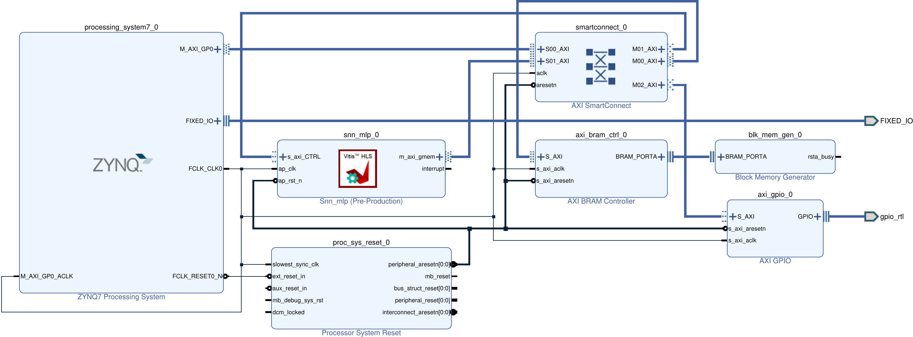

# Spiking Neural Networks for Embedded Vision
## From image features to FPGA inference with Vitis HLS

This lab presents a practical workflow for training and deploying a spiking neural network (SNN) on an FPGA to classify images into four classes: Full Cable, Left End, Right End, and No Cable. Images are converted to grayscale, resized to 60 × 80 pixels, and normalized. Sobel filtering generates ON and OFF edge masks, which are averaged over 5 × 5 cells to produce 384 input features. A fully connected SNN with leaky integrate-and-fire (LIF) neurons is trained using PyTorch and snnTorch, with output membrane potentials used for classification. The trained weights and biases are quantized and exported for accelerator implementation and verification in Vitis HLS. The generated RTL is then integrated into a Zynq-based Vivado design. Finally, Python sends preprocessed features over UART to the FPGA board, and the returned predictions, inference times, and membrane scores are used to evaluate hardware performance.

## Requirements

- One of the following options for the Python workflow:
  - Ubuntu 24.04 LTS installed directly on your computer; or
  - Ubuntu 24.04 LTS running through Windows Subsystem for Linux 2 (WSL 2); or
  - Python installed directly on Windows (requires Windows-specific commands to create and activate the virtual environment; package installation commands remain the same).
- Python 3.12 with `venv` and `pip`
- A Python virtual environment with the following packages installed:
  - PyTorch (`torch==2.12.0`)
  - snnTorch (`snntorch==0.9.4`)
  - NumPy (`numpy==1.26.4`)
  - OpenCV (`opencv-python==4.10.0.84`)
  - Matplotlib (`matplotlib==3.10.9`)
  - scikit-learn (`scikit-learn==1.9.0`)
  - tqdm (`tqdm==4.67.3`)
  - pyserial (`pyserial==3.5`)
- Sufficient RAM to cache the training and validation features
- AMD/Xilinx development tools: Vitis, Vitis HLS, and Vivado (course instructions use **version 2020.2**)
- PYNQ-Z2 FPGA board with Zynq-7020 (`xc7z020clg400-1`)
- USB Type-A to Micro-USB Type-B data cable for FPGA programming, UART communication, and power
- Course datasets and source files from the course GitHub repository

**Note:** Training can run on a CPU. GPU acceleration is optional and requires a CUDA-capable GPU, a compatible driver, and a compatible PyTorch installation. The script automatically selects CUDA when available; otherwise, it uses the CPU.

**Note:** The Python installation instructions below are provided for Linux (Ubuntu), including Ubuntu running under WSL 2. For native Windows, use Windows-specific commands to install Python and create and activate the virtual environment. The `python -m pip` commands remain the same once the environment is activated. Update the dataset and output paths in the source code to match your computer.

## Disclaimer

The FPGA deployment instructions were prepared using Vitis, Vitis HLS, and Vivado **2020.2**. Newer versions may have different menus, project workflows, or settings. Adjust the steps as needed for your installed software versions.

Installation of the FPGA development tools and access to the FPGA board require separate setup. These tools and the FPGA board are needed for hardware deployment, but are not required to train the SNN in Python.


## Instructions

**Note:** Some packages and versions differ from those used in the CNN lab. Create a separate virtual environment named `snn_env` for this lab.

### 1. Install Python prerequisites

Open an Ubuntu terminal. If you are using WSL 2 on Windows, open your Ubuntu terminal.

Install Python 3.12, `venv`, and `pip`:

```bash
sudo apt update
sudo apt install python3.12 python3.12-venv python3-pip
```

### 2. Create and activate a Python virtual environment

Open a terminal in your project folder and create a virtual environment named `snn_env` using Python 3.12:

```bash
/usr/bin/python3.12 -m venv snn_env
```

Activate the virtual environment:

```bash
source snn_env/bin/activate
```

Verify the Python version:

```bash
python --version
```

The output should show `Python 3.12.x`. Keep the virtual environment activated when installing packages or running the Python scripts.

### 3. Install the required Python packages

With the `snn_env` virtual environment activated, upgrade `pip`:

```bash
python -m pip install --upgrade pip
```

Install the required packages using the specified versions:

```bash
python -m pip install torch==2.12.0 snntorch==0.9.4 numpy==1.26.4 opencv-python==4.10.0.84 matplotlib==3.10.9 scikit-learn==1.9.0 tqdm==4.67.3 pyserial==3.5
```

The packages are used for:

- **PyTorch:** building and training the neural network, computing gradients, and saving model weights
- **snnTorch:** implementing leaky integrate-and-fire neurons and surrogate gradients for SNN training
- **NumPy:** numerical arrays, feature processing, and weight quantization
- **OpenCV (`opencv-python`):** image loading, resizing, and Sobel edge extraction
- **Matplotlib:** plotting ON/OFF spike maps and training and validation accuracy
- **scikit-learn:** splitting the dataset into training and validation sets while preserving class proportions
- **tqdm:** displaying progress bars during feature caching
- **pyserial:** sending quantized image features to the FPGA and receiving predictions, execution times, and logits over UART

**Note:** CPU training is supported. GPU acceleration is optional and requires a CUDA-capable GPU, a compatible driver, and a compatible PyTorch installation. The training script automatically selects CUDA when available; otherwise, it uses the CPU.

### 4. Verify the installed packages

List the installed packages and their versions:

```bash
python -m pip list
```

Check for dependency conflicts:

```bash
python -m pip check
```

Verify that all required packages can be imported:

```bash
python -c "import torch, snntorch, numpy, cv2, matplotlib, sklearn, tqdm, serial; print('All required packages imported successfully.'); print('CUDA available:', torch.cuda.is_available())"
```

### 5. Install Vitis, Vitis HLS, and Vivado

Download the **Unified Installer for version 2020.2** from the [AMD download page](https://www.amd.com/en/support/downloads/adaptive-socs-and-fpgas/development-tools/2020-2.html).

Run the installer and select **Vitis** as the installation product. Ensure that **Vitis, Vitis HLS, and Vivado** are included, along with device support for **Zynq-7000**.

Complete the installation. **Version 2020.2 is preferred** because it matches the tools used in this lab.

**Version note:** You may use a newer release, but menus, tool names, and project workflows may differ.

**Note:** If these tools and Zynq-7000 device support are already installed from the CNN lab, you do not need to reinstall them. The FPGA tools are required for hardware deployment, but are not needed for Python training.


### 6. Clone the course repository

Clone the SNN course repository once to obtain the datasets, source code, and presentation.

For Ubuntu, including Ubuntu running under WSL 2, install Git:

```bash
sudo apt update
sudo apt install git
```

For native Windows, install [Git for Windows](https://git-scm.com/download/win), then open Git Bash or PowerShell.

From your project folder, run the following commands, replacing `YOUR_SNN_REPOSITORY` with the actual repository name:

```bash
git clone https://github.com/dbaniya/YOUR_SNN_REPOSITORY.git
cd YOUR_SNN_REPOSITORY
```

The files referenced in the following steps are available inside this cloned repository, so you do not need to download them individually.

Keep using the `snn_env` virtual environment created in Step 2 when running Python scripts.


### 7. Locate the training dataset

Locate `new_training_data` in your cloned repository. If the dataset is compressed, extract it into your project folder.

Confirm that the folder contains the following four class folders:

- `Full Cable`
- `Left End`
- `Right End`
- `No Cable`

Note the absolute path of the `new_training_data` folder, as you will use it in the SNN training script.

### 8. Set the training dataset and output paths

Open the SNN training script in your cloned repository and set `ROOT` to the absolute path of your `new_training_data` folder:

```python
ROOT = Path("/absolute/path/to/new_training_data")
```

Replace `/absolute/path/to/new_training_data` with the actual dataset path.

Set `OUT_DIR` to the folder where you want to save the training outputs:

```python
OUT_DIR = Path("/absolute/path/to/snn_mlp_model")
```

Replace `/absolute/path/to/snn_mlp_model` with your preferred output path. The script automatically creates this folder and its subfolders.

The outputs are organized as follows:

- **`models/`:** trained model weights and checkpoint
- **`models/fpga_export/`:** floating-point and INT16 weights, and the `fpga_weights.h` header for FPGA implementation
- **`plots/`:** ON/OFF spike timelines and training and validation accuracy plot
- **`reports/`:** training history in JSON and CSV formats, and ON/OFF spike data in JSON format
- **`run_info.txt`:** training configuration and dataset path

Save the script and keep the `snn_env` virtual environment activated when running it.

### 9. Train the SNN

Open `snn_mlp.py` in your cloned repository.

Confirm that `ROOT` and `OUT_DIR` point to the dataset and output folders configured in Step 8:

```python
ROOT = Path("/absolute/path/to/new_training_data")
OUT_DIR = Path("/absolute/path/to/snn_mlp_model")
```

Replace the example paths with your actual folder paths, then save the script.

Open a terminal in the folder containing the script. With the `snn_env` virtual environment activated, run:

```bash
python snn_mlp.py
```

The script first displays ON/OFF spike visualizations for one image from each class. Close each plot window to continue.

It then caches the image features in RAM and trains the SNN using a 70% training and 30% validation split. Training runs on the GPU if CUDA is available; otherwise, it uses the CPU.

Wait for training and validation to complete. Close the final accuracy plot window to allow the script to save the model, reports, and FPGA weights.

After completion, confirm that the output folder contains `models/`, `plots/`, `reports/`, and `run_info.txt`. The header required for HLS implementation is saved at:

```text
models/fpga_export/fpga_weights.h
```

### 11. Create a new Vitis HLS project

Open **Vitis HLS** and select **Create New Project**.

Enter a project name and choose a location for the project, then click **Next** to continue through the project wizard.

### 12. Set the top-level function

Set the top-level function to **`snn_mlp`**. This name must exactly match the function in the provided C++ source code that implements the SNN accelerator.

- **Vitis HLS 2020.2:** Set **Top Function** to `snn_mlp` in the project settings.
- **Vitis 2026.1:** Open **Settings → hls_config.cfg**, locate **`hls.syn.top`** (“Name of the function to be synthesized”), and enter `snn_mlp`.

Save the settings before running C simulation or C synthesis.


### 13. Select the target FPGA part

During the Vitis HLS project setup, go to the **Solution Configuration** window and select the following FPGA part:

`xc7z020clg400-1`

This is the **Zynq-7020** device used on the **PYNQ-Z2** board.


### 14. Add the SNN source file

Locate `snn_mlp.cpp` in your cloned repository.

Open your Vitis HLS project and add `snn_mlp.cpp` under **Source**.

### 15. Add the test bench file

Locate `snn_mlp_tb.cpp` in your cloned repository and ensure it is in the same folder as `snn_mlp.cpp`.

In your Vitis HLS project, add `snn_mlp_tb.cpp` under **Test Bench**. This file tests the SNN implementation using the test dataset.

### 16. Copy the exported model weights

Locate `fpga_weights.h` generated during Python training inside your configured output folder:

```text
models/fpga_export/fpga_weights.h
```

Copy this header into the folder containing:

- `snn_mlp.cpp`
- `snn_mlp_tb.cpp`

Open your Vitis HLS project and add `fpga_weights.h` under **Source**.

Keep the filename `fpga_weights.h` unchanged so the HLS source code and test bench can locate the exported weights.

### 17. Prepare the HLS test dataset

Locate `fpga_test_features` in your cloned repository. Copy it—or extract it if compressed—into the same folder as the HLS source file, test bench, and `fpga_weights.h`. If it is already there, no copy is needed.

Keep the folder name `fpga_test_features` unchanged and preserve the four class folders and their `.txt` feature files.

In `snn_mlp_tb.cpp`, set `root` to the absolute path of this folder:

```cpp
const std::string root =
    "/absolute/path/to/fpga_test_features";
```

Replace the example path with the actual folder path, then save the test bench.


### 18. Run C synthesis and inspect the report

In Vitis HLS, select **Run C Synthesis**. Once synthesis finishes, open the **Synthesis Summary Report** and examine:

- **Performance estimates:** estimated clock period, latency, and initiation interval
- **Resource estimates:** BRAM, DSP, flip-flop (FF), and lookup table (LUT) usage

These estimates indicate the SNN accelerator’s expected execution time and FPGA resource requirements.

### 19. Run C simulation and inspect the results

In Vitis HLS, select **Run C Simulation**. In the simulation settings, enable **Clean Build**, then run the simulation.

Once simulation finishes, inspect the predicted classes, output logits, overall accuracy, and confusion matrix to assess the SNN’s classification performance on the test dataset.

The test bench uses up to 10 feature files per class by default, for a maximum of 40 test samples.

### 20. Export the RTL as a Vivado IP

In Vitis HLS, select **Solution → Export RTL**.

In the **Export RTL** window:

- Set the export format to **Vivado IP (.zip)**.
- Select **VHDL** as the RTL language for evaluating the generated RTL.

Start the export and wait for it to finish.

### 21. Locate the exported IP package

After **Export RTL** finishes, open your Vitis HLS project’s solution folder, then open the `impl` folder.

Confirm that `export.zip` is present. This ZIP file contains the packaged SNN IP for use in Vivado.


### 22. Create the Vivado project and block design

Create a new project in **Vivado** and build the design shown below.



- Add the **Zynq7 Processing System** first, then run **Block Automation** to apply the board settings.
- Open **Tools → Settings → IP → Repository**, click **Add Repository**, and select the `impl/ip` folder inside your Vitis HLS solution directory.
- Confirm that the custom **SNN IP (`snn_mlp`)** appears in the **IP Catalog**, then add it and the remaining IP blocks. Connect them as shown in the figure above.
- If your design includes the optional **`gpio_rtl`** interface for latency measurement, make it external only if you intend to connect a measurement instrument. An external GPIO requires the corresponding XDC pin constraints.
- Open the **Address Editor** and confirm that the SNN IP’s AXI control interface has an assigned address. If it appears under **Unassigned**, click **Auto Assign Address**.

### 23. Set the top module in Vivado

In Vivado’s **Sources** window, expand **Design Sources**, right-click the appropriate top-level module for your design, and select **Set as Top**.

For a block design, select its generated **HDL wrapper** as the top module. If the wrapper has not been created, right-click the block design and select **Create HDL Wrapper** first.

### 24. Configure a GPIO for inference latency measurement (optional)

If you intend to measure inference latency using an oscilloscope or logic analyzer, make the GPIO interface external and add the following pin constraints to your Vivado `.xdc` file.

**If you do not use this GPIO, do not make the interface external.** No pin constraints are needed for an internal GPIO interface. An XDC file may still be required for other external ports or timing constraints.

For the **PYNQ-Z2**, these constraints connect **`gpio_rtl_tri_io[0]`** to FPGA package pin **U7**, which connects to **physical pin 11** on the 40-pin Raspberry Pi header.

| Identifier | Meaning |
|---|---|
| **GPIO17** | Raspberry Pi GPIO signal number |
| **Pin 11** | Physical position on the 40-pin Raspberry Pi header |
| **U7** | FPGA package pin connected to it on the PYNQ-Z2 |

**GPIO17 does not mean physical pin 17.**

```tcl
set_property PACKAGE_PIN U7 [get_ports {gpio_rtl_tri_io[0]}]
set_property IOSTANDARD LVCMOS33 [get_ports {gpio_rtl_tri_io[0]}]
```

Ensure that **`gpio_rtl_tri_io[0]`** matches the port name in your HDL wrapper.

Connect the oscilloscope or logic analyzer signal probe to **physical pin 11** and its ground lead to a **GND pin** on the board.

In the Processing System application, configure the GPIO as an output. Drive it high immediately before starting SNN inference and low after inference completes. Measure the pulse duration to determine the elapsed time between these GPIO transitions, including any software overhead.

Apply the constraints before running implementation and generating the bitstream.

### 25. Validate the design and generate the bitstream

In Vivado, open the block design and select **Validate Design**. Resolve any reported errors before continuing.

From the **Flow Navigator**, run the following steps in order:

1. **Run Synthesis**
2. **Run Implementation**
3. **Generate Bitstream**

Wait for each step to complete successfully before proceeding to the next.

### 26. Export the hardware platform

Once the bitstream has been generated successfully, select **File → Export → Export Hardware** in Vivado.

In the export wizard, select **Include bitstream**, choose the output location, then click **Next** and **Finish**.

This creates an `.xsa` hardware platform file containing the hardware design and bitstream for use in Vitis.

### 27. Locate the exported XSA file

Open an Ubuntu terminal and run the following command to search your home folder and its subfolders for `.xsa` files:

```bash
find ~ -type f -name "*.xsa"
```

The output lists the full paths of matching files. Note the path of the `.xsa` file exported from your Vivado project, as you will select it when creating the platform project in Vitis.


